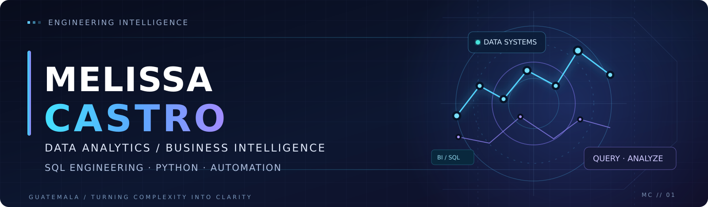
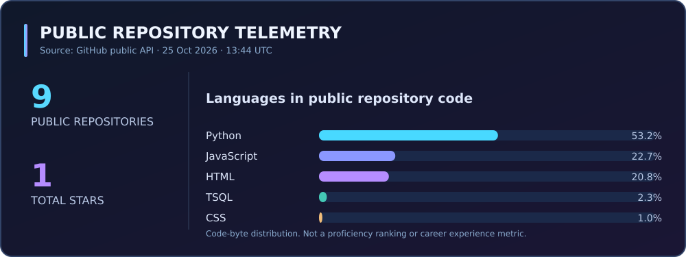

<!--
  MELISSA CASTRO | ENGINEERING PORTFOLIO
  Theme: cyber-noir / electric cyan + violet
  Statistics describe public GitHub repositories, not professional seniority.
  Public labs use original, synthetic data only.
-->

<p align="center">
  
</p>

<p align="center">
  <a href="https://github.com/Dicureck?tab=repositories"></a>
  <a href="./knowledge-base/README.md"></a>
  <a href="./knowledge-base/portfolio-roadmap.md"></a>
  <a href="mailto:info@intebi.online"></a>
</p>

<p align="center">
  
</p>

<p align="center"><b>Data Analytics &nbsp;·&nbsp; Business Intelligence &nbsp;·&nbsp; SQL Engineering &nbsp;·&nbsp; Automation</b></p>

---

### `01 / ENGINEERING PROFILE`

I build solutions at the intersection of **data analytics, database engineering, business intelligence, and process improvement**. My work spans SQL analysis and optimization, SQL Server → Oracle modernization, operational reporting, and decision-focused dashboards.

**My engineering principles:** verify the underlying data, define the business contract, document trade-offs, test repeatably, and communicate results with appropriate limitations.

> **Engineering clarity from complexity.** Useful systems are reliable, understandable, and built for real decisions.

### `02 / PROGRAMMING & QUERY LANGUAGES`

**Programming, scripting & automation** · clickable badges lead to code when available.

<p>
  <a href="https://github.com/Dicureck/sql-performance-lab/tree/main/src/perf_lab"></a>
  <a href="https://github.com/Dicureck/challenge-amigo-secreto-esp_main/blob/main/app.js"></a>
  
  
</p>

**Database & query languages**

<p>
  <a href="https://github.com/Dicureck/sql-performance-lab/tree/main/sql"></a>
  <a href="https://github.com/Dicureck/oracle-migration-toolkit/tree/main/sql/oracle"></a>
  <a href="https://github.com/Dicureck/sql-performance-lab/tree/main/sql"></a>
</p>

**Analytics, databases & tooling**

<p>
  
  
  
  
  
  
  
  
  
</p>

**Reporting engineering & responsible automation (next demonstrations)**

[Tableau · Crystal Reports · Report Builder · C# · ChatGPT / Claude workflows · automated reporting](./knowledge-base/reporting-and-automation.md)

<sub>C# and Java represent additional familiarity, not currently published application case studies. Technology badges represent tools and practices; repository language statistics below only describe public code.</sub>

### `03 / FEATURED ENGINEERING LABS`

**Independent public demonstrations** — built with synthetic data and original examples, separate from proprietary enterprise work.

| Project | Engineering focus | Verification |
|:--|:--|:--|
| **[SQL Performance Lab](https://github.com/Dicureck/sql-performance-lab)** | Query optimization, reproducible T-SQL scenarios, result-set integrity checks, benchmark methodology | [](https://github.com/Dicureck/sql-performance-lab/actions/workflows/ci.yml) |
| **[Oracle Migration Toolkit](https://github.com/Dicureck/oracle-migration-toolkit)** | T-SQL → PL/SQL review, dependency planning, data-contract checks, CSV reconciliation | [](https://github.com/Dicureck/oracle-migration-toolkit/actions/workflows/ci.yml) |
| **[Logistics & Route Intelligence](https://github.com/Dicureck/logistics-route-intelligence)** | Synthetic delivery operations, SLA contracts, geofences and reproducible offline dashboard | [](https://github.com/Dicureck/logistics-route-intelligence/actions/workflows/ci.yml) |
| **[Financial Intelligence Lab](https://github.com/Dicureck/financial-intelligence-lab)** | Auditable fictional P&L, operating margins, budget variances and BI modeling | [](https://github.com/Dicureck/financial-intelligence-lab/actions/workflows/ci.yml) |
| **[Data Quality Toolkit](https://github.com/Dicureck/data-quality-toolkit)** | Data contracts, validation gates, duplicate-aware reconciliation and CLI evidence | [](https://github.com/Dicureck/data-quality-toolkit/actions/workflows/ci.yml) |
| **[Secret Friend](https://github.com/Dicureck/challenge-amigo-secreto-esp_main)** | Client-side JavaScript, input validation, randomized selection | [Source code](https://github.com/Dicureck/challenge-amigo-secreto-esp_main/blob/main/app.js) |

**Next demonstrations:** operational incident analytics, advanced BI reporting (Tableau / Crystal Reports / Report Builder), responsible AI-assisted web development, and email/process automation. [Track their actual status](./knowledge-base/portfolio-roadmap.md).

### `04 / PROFESSIONAL FOCUS`

| Domain | Engineering contribution |
|:--|:--|
| **SQL performance** | Query analysis, stored-procedure optimization, controlled comparisons, and regression checks. |
| **Database modernization** | Object conversion, dependency assessment, migration validation, and PL/SQL compatibility review. |
| **Business intelligence** | KPI definitions, dashboarding, productivity analysis, and operational/financial reporting. |
| **Automation & data quality** | Reproducible checks, consistency analysis, and validation-driven workflows. |

Professional experience is summarized at a high level. **No client source, business data, production configuration, or confidential measurements appear in these repositories.**

### `05 / ENGINEERING KNOWLEDGE BASE`

An evolving, version-controlled **technical Wiki-style playbook** with decision frameworks, checklists, and links to working public labs.

<table>
  <tr><td>⚡ <a href="./knowledge-base/sql-performance.md"><b>Performance Engineering</b></a></td><td>🔁 <a href="./knowledge-base/database-migration.md"><b>Database Migration</b></a></td></tr>
  <tr><td>✅ <a href="./knowledge-base/data-quality.md"><b>Data Quality & Testing</b></a></td><td>📊 <a href="./knowledge-base/analytics-engineering.md"><b>Analytics Engineering</b></a></td></tr>
  <tr><td>🔒 <a href="./knowledge-base/portfolio-standards.md"><b>Publication Standards</b></a></td><td>🗺️ <a href="./knowledge-base/portfolio-roadmap.md"><b>Portfolio Roadmap</b></a></td></tr>
  <tr><td>🛠️ <a href="./knowledge-base/reporting-and-automation.md"><b>Reporting Platforms & AI Automation</b></a></td><td>📍 <a href="https://github.com/Dicureck/logistics-route-intelligence"><b>Operations Intelligence</b></a></td></tr>
</table>

<p align="center"><a href="./knowledge-base/README.md"></a></p>

### `06 / VERIFIED GITHUB TELEMETRY`

<p align="center">
  
</p>

<p align="center">
  <a href="https://github.com/Dicureck?tab=repositories"></a>
  <a href="https://github.com/Dicureck?tab=overview"></a>
  <a href="https://github.com/Dicureck/Dicureck/actions/workflows/telemetry.yml"></a>
</p>

<sub>Stats are generated daily from GitHub's public API by [a version-controlled Python script](./scripts/refresh_telemetry.py), not from a third-party chart provider. Repository language percentages use code-byte counts, not professional proficiency or career contribution. The initial placeholder updates after the first successful workflow run.</sub>

### `07 / HOW I ENGINEER SOLUTIONS`

```text
BUSINESS QUESTION
       │
       ▼
DATA DISCOVERY / VALIDATION
       │
       ▼
SQL · PYTHON · DATA MODELING
       │
       ▼
QUALITY & REPRODUCIBILITY CHECKS
       │
       ▼
INSIGHTS · AUTOMATION · DECISIONS
```

### `08 / LET'S BUILD SOMETHING USEFUL`

I value engineering that is measurable, understandable, secure, and maintainable.

**Explore:** [Projects](https://github.com/Dicureck?tab=repositories) · [Engineering notes](./knowledge-base/README.md) · **Business inquiries:** [info@intebi.online](mailto:info@intebi.online)

<p align="center"><sub>Designed for impact. Engineered with intention. · Melissa Castro · Guatemala</sub></p>
